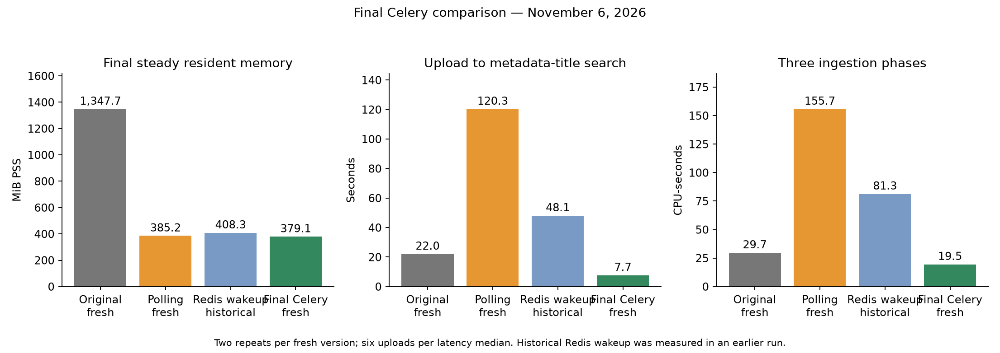

# OCR and rich metadata release validation

Validation date: 2026-11-05. Tracker: [#43](https://github.com/Enucatl/paperless-ngx/issues/43);
release gate: [#49](https://github.com/Enucatl/paperless-ngx/issues/49).

**Release publication is withheld.** Live synthetic ingestion, reprocessing,
provider swap/backout and paired database/private-file restore now pass. These
checks do not establish representative-corpus parity, an upgrade from the supported
previous deployment, or equivalent-workload memory behavior. Keep the existing
deployment available until those remaining gates pass.

## Implemented scope and compatibility

| Issue | Result                                                                                   | Commit      |
| ----- | ---------------------------------------------------------------------------------------- | ----------- |
| #44   | Versioned proposal contract, behavior matrix and sanitized fixtures                      | `0edd18808` |
| #45   | Authorized atomic metadata application and durable recovery                              | `e4b57989f` |
| #46   | Installed OCR/metadata adapters and core OCR provenance publication                      | `3b40cb323` |
| #47   | Supervised processors, capability provisioning, Tasks diagnostics and PostgreSQL example | `72597e364` |
| #48   | Installation, provider swap and rollback runbook                                         | `e6306a8a2` |
| #49   | Runtime validation and queued execution fixes; publication gates remain open             | `f3c5aeb2c` |

The supported candidate pairs this core branch with `paperless-inference` 0.1.0,
Python 3.14 and PostgreSQL 18. Both wire contracts are version 1. The OCR adapter
accepts PDF input. Read [provider operations](provider-operations.md),
[processor deployment](processor-deployment.md), and the
[metadata contract](rich-metadata-contract.md) before installation. No database
migration was added by these changes. Provider rollback is not a database downgrade.

## Verification evidence

All tests ran in disposable Docker containers with `--rm --userns=host`;
dependencies and test artifacts stayed in temporary Docker storage. Source was
read from the workspace with bytecode/caches disabled or copied into the container.
Counts below overlap and must not be added into one total.

| Check                                                                              | Result                                                                                               |
| ---------------------------------------------------------------------------------- | ---------------------------------------------------------------------------------------------------- |
| Pure rich-metadata contract                                                        | 42 passed                                                                                            |
| Core application on PostgreSQL 18                                                  | 53 passed, including concurrent creation and recovery                                                |
| Installed provider/baseline archive suite                                          | 93 passed, including real Ghostscript and veraPDF archive validation                                 |
| Core parser/provenance suite                                                       | 85 passed; later provenance additions have focused coverage                                          |
| Processor/service/backend suite                                                    | 124 passed                                                                                           |
| Tasks frontend suite                                                               | 51 passed                                                                                            |
| Integrated core/service regression selection                                       | 160 passed, 1 PostgreSQL-only skip on SQLite                                                         |
| PostgreSQL worker registration, document updates, rich metadata and OCR provenance | 62 passed                                                                                            |
| PostgreSQL processor cursor and worker-registration regressions                    | 19 passed                                                                                            |
| Final core correctness pass                                                        | 115 passed on PostgreSQL; 114 passed and 1 PostgreSQL-only skip on SQLite                            |
| Final provider payload/default checks                                              | 12 passed                                                                                            |
| Secret-file authentication and provider regressions                                | 16 passed; file precedence, rotation, missing/blank fallback and secret-free snapshots               |
| Core/provider dependency compatibility                                             | All shared locked core versions unchanged; `uv pip check` passed                                     |
| Installation/runbook smoke checks                                                  | Fresh SQLite migration/provisioning, PostgreSQL dump/restore and data/media archive roundtrip passed |
| Production frontend compilation                                                    | Passed as part of the core image build                                                               |
| Migration drift                                                                    | `manage.py makemigrations --check --dry-run`: no changes detected                                    |

The six pre-existing document-update search failures reproduced before this
release work. Those tests now use the existing `queued_search_processor` fixture,
which claims and completes real durable search operations before asserting real
index results. This does not restore synchronous indexing in production.

An actual fresh stack exposed a missing Celery registration: the worker discarded
`documents.search_operations.run_search` as an unknown task. Rich enrichment was
also absent from the worker registry. `CELERY_IMPORTS` now explicitly loads both
coordinator modules. The existing fresh-process worker test asserts their presence
in the real metadata registry and checks parent/child task parity.

The PostgreSQL deployment also exposed a cursor-lifetime bug: publishing a task
can close an obsolete database connection, invalidating the processor's open
server-side cursor after its first operation. A sweep now snapshots only job IDs,
then reloads each still-waiting job before processing. The PostgreSQL regression
closes the connection during the first operation and verifies that the second job
still runs; large OCR result payloads are not all retained in the sweep snapshot.

## Final correctness, consistency and simplification pass

Independent reviewers traced the combined core, provider, deployment and operator
paths. The final review commit fixes three further issues:

- Managed metadata updates now write only proposed custom fields. Previously,
  rewriting unrelated document-link fields could modify linked documents and
  reconcile their files inside the metadata transaction.
- OCR commits before admitting its deterministic metadata child. A missing or
  changed managed field now leaves successful OCR readable and recoverable,
  instead of rolling it back. Intervening document edits block stale admission;
  resuming the committed job does not repeat OCR.
- Metadata inference again defaults to the baseline's `reasoning_effort=minimal`,
  while preserving explicit overrides and an empty opt-out. Transport tests check
  the actual outgoing setting.

The pass also removed 16 lines of unused parser registry attributes/methods from
the explicitly selected provider and aligned the recovery and provider documents
with the final behavior. Relevant Ruff formatting/lint and whitespace checks
passed. No unresolved correctness finding remained in those reviewed paths;
this is not a claim that all upstream code or live deployment gates were checked.

Each issue had a fresh implementation agent and a separate commit. Existing user
changes in the two CI workflows and `docs/memory-analysis.md` were preserved and
excluded from these commits. Temporary test environments were removed after
verification; the local candidate images below remain available for inspection.

## Image and deployment evidence

The exact core Dockerfile first failed on transient GitHub HTTP 504 responses.
The S6 asset succeeded on retry. The pinned `jbig2enc_0.30-1_amd64.deb` download
continued to fail through the browser-download URL. A temporary validation
Dockerfile fetched the same release asset through GitHub's asset API instead;
SHA-256 was checked against the release digest:

```text
993507c43d128393d22d14a8646492336aca6b6327f227d75df8a1009f1f364f
```

No dependency version or repository Dockerfile was changed to bypass the failure.
The core image and its provider extension built successfully. These are local
`:validation` and `:secrets-validation` images, not published release artifacts. The build includes the
production frontend. Repeating the unmodified build still depends on the upstream
asset download route being available.

An isolated PostgreSQL 18 + Valkey 9 + Paperless stack reached HTTP 200, completed
migrations and system checks, and provisioned the capability-only account. This
used disposable test data and no production documents. The initial startup found
the task-registration defect above. Rebuilt images include both runtime fixes and
the final core/provider correctness fixes. The resulting stack started successfully,
registered both tasks, and completed a search admitted after an idle period without
manual processor commands. The query returned the synthetic document and all three
retained search jobs were `succeeded`. No unregistered-task or cursor error occurred
in that final run.

Final local image IDs (tested worktree based on `e6306a8a2`, including the fixes in
this report and the final review changes):

```text
paperless-release49-core:validation
sha256:66dd987e04bf062761afeaaf87d427ac673779a1e336ddb55b1332203be61de2
paperless-release49-inference:validation
sha256:4fa068145bb1b01b54d460a4981c82f33418a05f0a1544ae66cd289d2a34a48b
```

## Limited runtime measurements

These measurements cover the shipped default service classes, one autoscaling
worker, the ten-second processor sweep, PostgreSQL and Valkey on Linux x86-64.
They are a small synthetic search smoke workload, **not** OCR/metadata performance
or a comparison with the previous deployment. Periodic sweeps and scheduled tasks
remain active during nominal idle time. The host exposed 15.05 GiB to Docker.

The recreated app reached HTTP 200 after 11.07 seconds. A search admitted after
the idle interval completed in approximately 10.65 seconds, measured from the
first coordinator receipt to its final completion in worker logs. The real index
query confirmed the result. This includes the configured sweep wait.

| Service                                | Post-startup working-set snapshot | 20+ seconds after search | Cumulative cgroup peak |
| -------------------------------------- | --------------------------------: | -----------------------: | ---------------------: |
| Paperless and its supervised processes |                         646.4 MiB |                546.5 MiB |             804.42 MiB |
| PostgreSQL 18                          |                         42.25 MiB |                42.59 MiB |             113.00 MiB |
| Valkey 9                               |                          5.40 MiB |                 5.63 MiB |              14.61 MiB |

Working-set snapshots come from `docker stats --no-stream`; cumulative peaks come
from each container's cgroup-v2 `memory.peak` and include file cache. Peaks are
not simultaneous and must not be summed. PostgreSQL/Valkey peaks include initial
migrations and the earlier validation app restart. These are individual snapshots,
not steady-state averages or a peak isolated to inference. Remote inference was
unavailable during this initial search-only run; the later successful live workload
and remote snapshots are recorded below. Neither set establishes an equivalent
whole-workload comparison or satisfies a target by itself.

## Live OCR and metadata continuation

The initial OCR timeout occurred while the workstation was unavailable. After it
started, `/health` and `/metadata` returned 200 with pipeline `PaddleOCR-VL-1.6`,
model `PaddlePaddle/PaddleOCR-VL-1.6`, and layout model `PP-DocLayoutV3`.

The earlier metadata HTTP 401 was a **credential-loading regression**, not proof
that the real key was invalid: the baseline loads `OPENROUTER_API_KEY_FILE` and
`OPENAI_API_KEY_FILE`, while the extracted adapter initially read only direct
environment values. The adapter now reads those files at execution, prioritizes
nonempty file values, and retains the previous runner's missing/blank-file fallback.
Credentials never enter configuration snapshots. Tests cover precedence, rotation,
fallback and absence from snapshots. The actual key was transferred privately to a
temporary read-only Docker secret volume, readable only by application UID 1000;
its bytes were not printed, added to the repository, or baked into an image.

The installed candidate used for the live continuation and final backout/restore:

```text
paperless-release49-inference:secrets-validation
sha256:6824eec4681c4087dbff484efab2b1da399c7b0e3adfd614ed78afbabfa6fc1a
```

This extends the core image above with the secret-file fix on the worktree based
on `2d027485f`. All data was synthetic and isolated from production. Normal HTTP
API admission/reprocessing used a temporary authenticated test user; processors
used the dedicated capability account. No listener or separate stage queue ran.

| Live check                                                                          | Result                                                                                                                     |
| ----------------------------------------------------------------------------------- | -------------------------------------------------------------------------------------------------------------------------- |
| Installed metadata provider, synthetic invoice                                      | Valid complete proposal in 2.232 seconds                                                                                   |
| Existing-document metadata application and ordinary search                          | Passed; title/date/summary/processing date/audit/correspondent/language applied; unrelated tag and custom field preserved  |
| New PDF through authenticated upload → OCR → archive/provenance → metadata → search | Passed; ingestion 100.417 seconds, metadata child 13.644 seconds                                                           |
| OCR endpoint compute elapsed reported in provenance                                 | 0.851 seconds, distinct from queue and publication latency                                                                 |
| Published files                                                                     | 1,038-byte original; 9,565-byte searchable archive; all four managed metadata/provenance fields present                    |
| API reprocess of the existing uploaded PDF                                          | Passed in 20.177 seconds; retained user title, unrelated tag/custom field and non-OCR metadata                             |
| Archive/source integrity                                                            | Original SHA-256 unchanged and matched OCR provenance; archive text searchable; actual veraPDF validation passed           |
| Provider swap to built-in `DefaultParser`                                           | Fresh reprocess passed in 9.809 seconds; metadata and existing archive preserved                                           |
| Pending work during provider swap                                                   | Old Paddle job rejected before retry with `Processing configuration or provider changed before retry`; no silent rerouting |
| Swap back to installed Paddle provider                                              | Fresh reprocess passed in 19.746 seconds; metadata preserved and Paddle provenance verified                                |

The first management-shell metadata admission was accidentally run as root and
created a lock the application user could not open. The isolated harness ownership
was corrected and the job explicitly resumed; that recovery was not counted as an
automatic-success path. Both current guides now run job/recovery commands as
`--user paperless`. Subsequent full ingestion and reprocessing used the HTTP API
and completed through supervised processors without manual launches.

One intermediate search job reached `attention`: its write had executed and its
result was staged, but metadata changed the retained projection before coordinator
acceptance. The final newer search completed and queries verified the current
record. This is the existing stale-result/review behavior, not an unknown inference
result; it does **not** mean every task succeeded or that no transient old search
projection existed. Search-job coalescing was not added in this release.

### Coordinated restore

After all nonterminal work drained, the application was stopped. A PostgreSQL
custom-format dump and the complete data/media trees were captured together,
then restored to independent database/data/media volumes with a fresh broker.
The restored application checked authenticated document access, current metadata,
original hash against OCR provenance, searchable archive, ordinary search, and
the rejected pending job's retained private input. This tests restoration of this
candidate's paired state; it is not a database downgrade or a previous-version
upgrade test.

### Live workload resource observations

A local snapshot taken just after the OCR lease notification showed Docker working
sets of 766.7 MiB (Paperless), 46.79 MiB (PostgreSQL), and 4.11 MiB (Valkey).
Corresponding cumulative cgroup peaks were 1,064.20 MiB, 125.23 MiB and 13.84 MiB.
A later drained snapshot after swap-back reprocessing showed 552.4 MiB, 44.27 MiB
and 4.84 MiB; its Paperless process had been recreated for the provider swap, so
this is **not** a same-process return-to-idle comparison. Observer management
processes and periodic services can contribute to these samples.

The remote RTX 5090 workstation snapshots at 16:50:22Z and 16:51:56Z both showed
11,824 / 32,607 MiB GPU allocation and 0% utilization. The short OCR compute had
already finished before sampling; these are neither active-compute nor peak
measurements. OCR VLM/API Docker working sets were approximately 3.32 GiB /
1.917–1.918 GiB, gateway 9.406 MiB. A separately loaded BGE service used 4.35 GiB;
its GPU allocation contributes to the total and must not be attributed to OCR.
Remote resources are reported separately from the local core stack.

## Instrumented memory and latency diagnosis (2026-11-05)

**The integrated deployment uses substantially less resident memory, but pays for
it with repeated process initialization, higher CPU consumption and serial queue
latency.** This is a diagnostic result, not a product fix or release certification.
One complete matched baseline/candidate pair passed. The next candidate run lost
OCR endpoint connectivity; its incomplete results are reported separately and
the second baseline was never run. No repeat-median claim is made.

The [machine-readable diagnostics](inference-release-diagnostics.json) contain
phase distributions, process attribution, timing bounds, CPU/I/O, identities and
the interrupted run. The [reproduction harness](../scripts/benchmarks/release_memory/README.md)
describes instrumentation and exclusions. Raw samples, private synthetic-service
logs, frozen scripts and derived data are retained in the local, unpublished
`artifacts/release-memory-20261105.tar.gz` archive. Earlier validation and its
Valkey measurements above remain historical evidence; this experiment uses Redis.


### What was compared

The old six-service deployment uses retained core revision
`8eb396d9833a56e6147092620b8832e39397f684`, plus its actual AI, listener and Phoenix
images. The integrated three-service deployment uses
`paperless-release49-inference:secrets-validation`, image
`sha256:6824eec4681c4087dbff484efab2b1da399c7b0e3adfd614ed78afbabfa6fc1a`.
Image configuration and root filesystem layers were verified after transfer;
Docker's classic and containerd image stores report different image identifiers
for transferred contents. Original and local identifiers are retained in JSON.

Both stacks ran sequentially on the same eight-CPU Linux x86-64 host with
15.05 GiB Docker-visible RAM, fresh PostgreSQL 18 databases and Redis 8, one web
worker and one autoscaling task worker. The workload uploaded the same one-page
and three-page synthetic invoices, browsed metadata/previews, then uploaded
another one-page invoice after idle. Originals retained their hashes; OCR text,
managed fields, archive downloads and content search passed. Each complete run
has three 300-second nominal-idle windows and keeps the same application
container and HTTP process identities throughout. Scheduled work remains enabled.

The comparison normalizes old polling from its deployed **300 seconds to 10**,
matching the new sweep delay, and metadata temperature from deployed 1.0 to zero
on both sides. The isolated Phoenix instance disables authentication so real
inference traces are stored; it publishes no port. Model servers remain warm and
external; no chat workload runs. These settings describe a controlled comparison,
not the exact latency or resource use of the current production deployment.

### Memory: persistent savings and larger core bursts

PSS is proportional process memory: shared pages are apportioned rather than
counted once per process. Values below are medians of all 300 one-second samples
within each window, not endpoint snapshots or medians across repeated runs.

| Nominal-idle phase    | Old stack PSS MiB | Integrated PSS MiB | Reduction | Old / integrated working set MiB |
| --------------------- | ----------------: | -----------------: | --------: | -------------------------------: |
| Startup               |           1,054.1 |              366.3 |     65.3% |                  1,033.2 / 370.3 |
| After features        |           1,316.5 |              404.5 |     69.3% |                  1,255.4 / 421.1 |
| After later ingestion |           1,333.4 |              406.8 |     69.5% |                  1,295.5 / 423.4 |

Anonymous-memory medians corroborate the process-memory reduction: final idle
falls from **1,073.6 to 296.3 MiB**. The strongest attribution is removal of
resident Phoenix (about 504.8 MiB PSS), AI (105.8 MiB before use, about 244 MiB
after use), and the listener (68.3 MiB). PostgreSQL also shrinks, with fewer
application databases/connections. Core startup PSS actually rises slightly,
**282.9 to 297.3 MiB**; after features it is **388.0 versus 329.2 MiB**. This is
chiefly a deployment/lifetime saving, not a universally smaller web process.

The sampled simultaneous raw cgroup peak falls **1,856.4 to 1,063.7 MiB**, both
during the three-page upload. Working sets at those samples are **1,397.5 and
849.0 MiB**. Raw memory includes file cache. The sums of service lifetime peaks,
**1,980.1 and 1,100.2 MiB**, are upper bounds rather than simultaneous peaks.
The core container's own lifetime peak grows **649.4 to 964.4 MiB**: near the
integrated aggregate peak, PSS includes a 240.6 MiB processor sweep, its
136.5 MiB Java child, a 103.0 MiB task child and the 176.4 MiB HTTP child.
Processing has moved inside core; the full deployment still peaks lower.

The integrated HTTP child stays in the same process and grows from about
151.1 to 182.8 MiB PSS. A first sample without a task child or processor sweep
appears about 22 seconds into the post-feature window. This is a warmed idle
state, not a reset to startup. Post-feature and final nominal-idle windows include
about 10.35 and 7.98 seconds of late search completion before the newest projection
is accepted; their CPU averages are not measurements of fully drained idle.
Sweeps appear in 42/300, 42/300 and 43/300 idle
samples. Integrated idle PSS mean/P95 values are **402.1/456.6**, **423.9/491.3**
and **435.6/493.8 MiB**. Periodic children reappear and exit; one snapshot with a
worker does not establish a leak, and five minutes does not establish leak freedom.

Cache accounting matters. In the incomplete second candidate, startup/post-feature
PSS is almost unchanged at 366.4/404.3 MiB, but raw memory is about 98/132 MiB
lower, mostly because fewer cached file pages are charged to those cgroups.
Likewise, old-stack raw memory falls between the last two windows while PSS and
anonymous memory rise. Such raw reductions must not be credited as process release.

### Latency: queue waits dominate the request

The original workload marker checks populated metadata plus
`content:benchmarksearchable`. It can pass against an earlier OCR search
projection. The retained journal independently identifies when the **newest
metadata projection** is accepted, shown separately below. API polling adds up
to approximately one polling interval plus request time to the earlier marker;
journal transition bounds are approximately 100 ms, with measured query overhead.

| Upload              | Old content-search marker s | Integrated marker s | Integrated newest search accepted, from admission s | Integrated serial queue waits s |
| ------------------- | --------------------------: | ------------------: | --------------------------------------------------: | ------------------------------: |
| One page            |                      24.206 |             102.972 |                                             120.376 |                   87.713–88.614 |
| Three pages         |                      22.084 |             112.512 |                                             123.921 |                   94.524–95.426 |
| One page after idle |                      22.077 |             106.310 |                                             114.611 |                   90.617–91.519 |

The queue bounds sum nine required serial operations: six preparation plugins,
parser work, thumbnail work and metadata. **Preparation queues alone consume
55–65 seconds**, including checks that have little work on these inputs.
Execution through result staging for all nine sums only about **4.8–6.1 seconds**;
result acceptance/coordinator traversal adds further time. OCR request elapsed
is recorded separately in provenance; it includes transport/remote processing,
not just GPU kernels. The old metadata LLM spans take **1.42–1.77 seconds**.
These timings do not support attributing the roughly 90-second gap to model compute.

The mechanism is visible in both journal transitions and source:
[`execution_policy`](../src/documents/job_state.py) queues finite `prepare:*`
operations, [`prepare`](../src/documents/ingestion.py) defers each eligible plugin,
and [`invoke`](../src/documents/operation_journal.py) stops traversal after staging
the selected result. The [processor supervisor](https://github.com/Enucatl/paperless-ngx/blob/55928c30e0b842f4b881944a09d64fef8cd4ef3f/src/paperless_services/processor.py)
then exits that Django child, waits ten seconds and starts another sweep. Only
one newly available step of the same dependent ingestion chain is advanced in
each sweep. This explains repeated queue gaps and repeated initialization.
The early content marker precedes final search convergence by **8.3–17.4 seconds**.
Older stale search jobs can reach review/failure while newer jobs eventually
publish the correct projection; the complete run is not an all-tasks-success run.

### CPU and I/O: the memory saving has a recurring execution cost

| Phase                            | Old CPU-seconds | Integrated CPU-seconds |
| -------------------------------- | --------------: | ---------------------: |
| Startup nominal idle, 300 s      |            6.51 |                  50.34 |
| First ingestion                  |           10.77 |                  43.35 |
| Three-page ingestion             |            8.51 |                  50.37 |
| Post-feature nominal idle, 300 s |            4.21 |                  59.28 |
| Ingestion after idle             |            8.98 |                  46.90 |
| Final nominal idle, 300 s        |            8.00 |                  61.42 |

Ingestion totals are **28.26 versus 140.61 CPU-seconds (4.98×)**. The three equal
idle windows total **18.71 versus 171.04 CPU-seconds (9.14×)**. Integrated idle
consumes about 0.17–0.20 of one CPU on this eight-CPU host, despite low median RAM.
One-second process sampling directly attributes at least about **29–31 CPU-seconds
per idle window** to processor sweeps, out of core's approximately 48–49 seconds.
Short process tails and worker churn prevent exact allocation of the remainder;
this is a measured lower contribution, not an exclusive attribution of all CPU.

Ingestion block reads are similar (**56.95 versus 55.80 MiB**); writes are
**6.50 versus 15.49 MiB**. Warm subsequent candidate phases record no block reads.
Host pressure is low, with no OOM events, CPU throttling or sampled swap. The
observations support queue/process-lifecycle costs, not disk saturation, as the
principal explanation. CPU figures include periodic services, HTTP polling and
the database observer; they are not instrumentation-free production estimates.

### Remote resources stay resident

Per-process GPU attribution is stable across all 2,890 available remote samples:
**9,712 MiB OCR**, split between API (2,738 MiB) and VLM (6,974 MiB), plus
**2,060 MiB unrelated BGE**. Whole-GPU allocation is 11,824 MiB, leaving about
52 MiB outside those compute-process allocations. Neither BGE nor the full GPU
total should be charged to OCR alone. Sampled utilization peaks at 44%; short
peaks may fall between one-second samples and utilization/power are whole-device.

Final nominal-idle remote working sets are approximately **1,980 MiB API**,
**3,412 MiB VLM** and **10 MiB gateway** on either side. BGE separately retains
about 4,455 MiB host working set. Those are container working sets, not process
PSS or GPU allocations, and are not added to the local PSS table. The integration
does not remove model-serving residency. Model startup and OpenRouter hosting
resources/charges were not measured; cloud weights behind the shared model name
cannot be proven immutable by this client.

### Interrupted repetition and diagnostic mismatches

The remote stream ends at **20:37:37.812 UTC**, with SSH reporting a connection
closed by the remote host. The next after-idle upload arrives at **20:41:10.348**.
Its three parser attempts fail OCR `/metadata` probes with network-unreachable
errors. The durable job becomes **failed at 20:43:02.843**, **112.495 seconds**
after admission. Both HTTP and SSH remain unreachable at the later diagnostic
check. This establishes dependency/connectivity loss; it does not establish a
shutdown, reboot or specific network cause.

The harness waits to 900 seconds because its document-completion loop does not
stop on a terminal durable-job failure. **900 seconds is a harness deadline, not
OCR compute time.** It also saves API timing/result summaries only after a whole
run succeeds; the interrupted run retains process, memory, job and service-log
evidence, but lacks that final summary. The first matched pair is intact.

The failed job's top-level `PaperlessTask` remains `started` with no completion
date, while its serialized operation exposes `failed` and the error. Consequently
top-level status counts/filtering/duration can disagree with operation details;
the error is not hidden. Successful uploads also log misleading missing-permission
warnings for the core-owned parent `prepare:6` entry, which has no processing
policy while its finite parser child waits. Neither observation proves that the
dedicated account lacks its configured grants. These are diagnostic findings;
no production code was changed.

### Measurement limits and retained evidence

Local memory/process sampling and helpers run in disposable Docker containers;
the remote read-only sampler runs on Cerebrum through SSH.
Complete-service rows alone enter aggregate comparisons. Memory sampling takes
median **22.76 ms old / 11.72 ms integrated** per second. The read-only SQL
observer polls both stacks every 100 ms, but its query is heavier on candidate
journals: **0.614 / 3.144 ms mean**, **1.794 / 8.307 ms maximum**. Its process is
excluded from service totals, while its database execution/connection remains
inside PostgreSQL. Query wall time is not CPU time and cannot simply be subtracted.
Remote observation takes median 38 ms. Initial SSH probes bound relative clocks
roughly between −2.5 ms and +226 ms; the post-run probe is absent after connectivity
loss. Local API, process and database events share the same host clock.

The result establishes one bounded five-page English invoice workload and its
observed tradeoffs. It does not establish repeatability, representative corpus
parity, bulk throughput, long-run leak freedom, a universal 2 GiB active target or
3 GiB peak cap, or successful offline recovery after the interrupted repetition.
The next comparable repetition requires the model endpoint to be reachable.

## Three-version comparison after Redis wakeups (2026-11-06)

**All six measured runs completed: two original, two polling-integrated, and two
Redis-wakeup runs.** Removing periodic sweeps cuts nominal-idle CPU by about 76%
and upload-to-title-search latency by about 59% against polling. Steady resident
RAM remains close to the first integrated test, with higher memory during the
new 60-second child-retention period. Current latency remains about twice that
of the normalized original deployment; staged-result acceptance now dominates
remaining latency, alongside frequent coordinator child replacement. These are
measurements, not additional product fixes.

[Structured data](inference-release-comparison-20261106.json),
[summary plot](inference-release-comparison-summary.png), and
[time-series plot](inference-release-comparison-timeseries.png) retain the details.
The local unpublished raw archive is
`artifacts/release-comparison-20261106.tar.gz`. The November 5 report, JSON, plots
and raw archive above remain unchanged historical evidence.

### Versions and controlled workload

- **Original:** the retained six-service deployment, core `8eb396d9833a56e6147092620b8832e39397f684`.
- **First integrated test / polling:** the same retained image tested on November 5,
  `sha256:6824eec4681c4087dbff484efab2b1da399c7b0e3adfd614ed78afbabfa6fc1a`.
- **Current:** Redis-wakeup commit `55928c30e0b842f4b881944a09d64fef8cd4ef3f`,
  image `sha256:78803e4f1be2e64499067f2c3d25312fd6991d561a0cd76348e35d0209c20533`.
  It was built from an immutable Git archive over the retained inference image;
  dependencies, provider package and frontend were unchanged by that commit.

The run order was original → polling → current → current → polling → original.
Every run used fresh volumes, the same eight-CPU/15.05 GiB local host, pinned
PostgreSQL 18 image `bd5dfa494a5a…`, and pinned Redis 8 image `f245f4c83b84…`.
The historical PostgreSQL image identity was no longer available locally, so all
three versions were rerun on the same currently available image rather than
mixing yesterday's baseline with today's current run.

Each measured run uploaded identical one-page, three-page, then one-page PDFs,
with three 300-second observation windows: startup, after the initial two uploads,
and after the later upload. That is **18 measured uploads / 30 pages** overall;
the nine preflight uploads are excluded. Source hashes, managed fields, OCR,
archives, content search and metadata-title search passed. Original polling was
again normalized from its deployed 300 seconds to ten seconds; metadata
temperature was zero throughout. Model serving stayed warm and available.

This rerun records both the older content-word marker and a separate query for
the current metadata title. Observation windows now begin after title visibility
and download/metadata verification. Terminal upload-task/operation failures stop
promptly, and partial results are saved per upload. These observation changes
apply equally to all three fresh versions; historical timings are not silently
reinterpreted using the stronger marker.

Current retains its shipped **60-second processor idle timeout**. Its recovery
schedule also changes independently from every five minutes to daily at 03:00.
The experiment preserves those version defaults and counts logged recovery
deliveries separately. No model, worker-lifetime or product tuning was added.


### Main measurements

RAM, CPU totals and sampled peaks below are medians of two per-run statistics.
Title-search latency is the median of six balanced upload observations per
version. CPU totals include the database observer and scheduled services.

| Metric                                           | Original | First integrated / polling | Current / Redis wake |
| ------------------------------------------------ | -------: | -------------------------: | -------------------: |
| Final steady PSS, last 240 s, MiB                |  1,351.1 |                      398.9 |                408.3 |
| Final nominal-idle PSS mean, all 300 s, MiB      |  1,368.8 |                      428.6 |                474.0 |
| First 60 s of final idle, PSS median MiB         |  1,433.1 |                      485.8 |                766.0 |
| Sampled raw-memory peak, MiB                     |  1,985.5 |                    1,040.4 |              1,056.7 |
| Upload → metadata title searchable, s            |    22.54 |                     118.36 |                48.07 |
| Three ingestion phases, CPU-s                    |    29.40 |                     160.16 |                81.30 |
| Three nominal-idle windows, 900 s total, CPU-s   |    16.04 |                     174.60 |                41.11 |
| Core CPU during final 240 s of final idle, CPU-s |    0.399 |                     36.822 |                0.379 |
| HTTP API readiness from core launch, s           |    12.74 |                      13.00 |                14.00 |

The current steady PSS is about **70% below the original**, but **9–13 MiB above
polling** across the three quiet windows. Current mean RAM over the full final
window is higher than polling because initialized processing memory remains
resident for the first minute. The first-60 / last-240 split makes this tradeoff
visible; a single median or endpoint snapshot would hide it.

Current uses **49% less ingestion CPU** and **76% less nominal-idle CPU** than
polling. Its active CPU rate is higher, approximately 0.551 CPU-s per observed
second versus polling's 0.445: work is compressed into less elapsed time even
though total CPU falls. Original is approximately 0.432 CPU-s/s for these phases.
Block reads/writes during ingestion are 189.05/7.18 MiB original,
156.62/15.30 MiB polling, and 150.20/14.82 MiB current; cache/order effects remain.

Raw peak ranges overlap: polling **979–1,102 MiB**, current **1,013–1,100 MiB**.
This does not establish a new peak-RAM saving over polling. Both remain below the
original full deployment's **1,735–2,236 MiB** sampled peaks. Core-only lifetime
peaks are larger than the original's because processing resides inside core;
individual service lifetime peaks must not be summed as a simultaneous peak.


### Why CPU falls, and why early RAM is higher

Each polling run creates **106 observed provider-processing child identities**.
Each current run creates **three**: startup reconciliation, a child shared by the
first two uploads, and a fresh child for the after-idle upload. The same HTTP
child remains throughout each run. This directly verifies burst reuse and later
release without an HTTP/container restart.

In current1, provider PID 594301 handles both initial uploads and the beginning
of post-feature idle; PID 597472 handles the later upload. Current2 similarly
uses 607035 and 609233. Those initialized providers reach about 279–289 MiB PSS
and remain briefly for reuse, then leave after the quiet deadline. A blocked
resident Redis parent remains; it does not repeatedly initialize Django.

Observed provider CPU during idle drops from roughly **29–32 CPU-s per 300-second
window** to **0.02–0.18 CPU-s**. Active provider CPU contributions fall from
48.83/52.01 seconds in polling runs to about 7.55 seconds in current. These
process contributions are approximate lower bounds: one-second sampling misses
short process tails. Whole-container CPU counters include those tails.

Polling logs four scheduled recovery deliveries in each run, versus zero in
original/current. This supports treating the new recovery schedule as another
contributor. It does not account for the disappearance of repeated provider
children; their measured identities and CPU show that mechanism separately.
Logged deliveries do not count unlogged inline startup/reconnection recovery.

The remaining **whole-stack** idle CPU is not all product overhead. In current's
last 240-second final-idle window, core uses a median **0.379 CPU-s**, while
PostgreSQL uses about **10.109 CPU-s**, including the diagnostic observer's
10 queries/second. The observer is outside app-memory totals, but its SQL executes
inside the measured database. Query wall time cannot simply be subtracted from CPU.

### Latency improvement and the remaining coordinator cost

| Upload case, median of two repeats | Original title visible s | Polling title visible s | Current title visible s |
| ---------------------------------- | -----------------------: | ----------------------: | ----------------------: |
| First one-page PDF                 |                   23.088 |                 115.795 |                  50.961 |
| Immediate three-page PDF           |                   22.071 |                 124.995 |                  46.125 |
| One-page PDF after idle            |                   22.505 |                 118.361 |                  48.844 |

The nine serial finite operations now wait only **0.03–0.80 seconds in total when
the provider child is warm**, or **1.66–2.59 seconds cold**. Warm per-operation
pickup is below about 0.18 seconds in these observations. Provider reuse works;
the old roughly 90-second processor-polling delay is gone.

Execution through staging totals **3.58–6.35 seconds** for those operations.
However, **staged-result → coordinator acceptance still totals 27.73–36.74 seconds**.
Metadata-job admission also waits **2.42–5.76 seconds** for its initial coordinator
execution, outside those nine finite-operation queue intervals. Core publication,
other handoffs and one-second API polling account for additional elapsed time.

The remaining coordinator churn is directly observable: **14–15 sampled Celery
child identities appear per current upload**, with many child birth intervals
around **5.03–5.04 seconds**. Across each full run current has 53/56 observed task
children, compared with polling's 64/62 and original's 14/16. Source configures
`CELERY_WORKER_MAX_TASKS_PER_CHILD=1`; `ChildDjangoLoader` initializes Django in
each child. Installed Celery's asynchronous pool has a five-second maintenance
timer. Together, the timing and process evidence point to coordinator replacement
and initialization costs. The exact split between pool-maintenance waiting and
Django initialization was not separately profiled.

Removing the long provider queue gap exposes that existing cost: under polling,
coordinator replacement could overlap waiting for the next provider sweep. With
near-immediate provider execution, the next result is ready before a replacement
coordinator child can accept it. Increased acceptance-side time therefore does
not mean Redis pickup became slower. This overlap explanation is an inference
supported by timing/process evidence. Coordinator-side lock waits were not
instrumented, so their contribution cannot be ruled out. Processor-side retries
before a claim are bounded by the short pending-to-claim intervals; they cannot
explain the much longer acceptance-side total.

OCR endpoint elapsed time remains approximately **0.73 / 1.17 / 0.74 seconds**
for the three PDFs in every version. Current metadata-provider execution takes
**1.18–2.68 seconds**, including transport and proposal handling. These are not
GPU-kernel-only measurements and do not explain the remaining tens of seconds.

Title visibility and durable search acceptance remain different markers. For
example, current2's final title is query-visible at **51.990 seconds**, while the
related latest search job is accepted at **55.927 seconds**. All current search
jobs eventually succeed. Each polling run retains three stale-projection
`attention` jobs and six misleading parent-permission warnings; neither appears
in the current runs. This success workload does not retest the earlier terminal
failure/top-level task-status mismatch.

### Remote resources and observation quality

All **6,756 remote samples** span the measured runs without an error. OCR GPU
allocation is constant at **8,920 MiB**; whole-device allocation is 8,967 MiB.
BGE is absent after this boot, rather than being started just for the benchmark.
Remote working sets are about **2,629 MiB API**, **5,368 MiB VLM**, and **16 MiB
gateway**, effectively unchanged across all three fresh versions. These differ
from the previous boot's observations; none of that inter-day difference is
attributed to the local polling change. GPU utilization reaches 85% in sampled
whole-device observations; sub-second peaks and per-process utilization are not
established. Cloud model hosting resources and charges remain unmeasured.

All measured service cgroup reads succeeded, with monotonic sample intervals;
aggregate comparisons exclude partial startup rows before all services exist.
Recorded idle boundaries yield exactly **300 / 60 / 240 samples** for
whole / early / later windows. One baseline2 phase-labelled sample at +300.054
seconds is retained raw but excluded from the completed 300-second window.
Short-lived process-read races remain explicitly recorded rather than fabricated
as zero-memory processes.

Median memory/process observation cost is about **22.4–22.5 ms/second original**,
**12.2 ms polling**, and **11.9–12.5 ms current**. Mean SQL observation latency is
**0.63–0.64 ms original**, **3.35–3.37 ms polling**, and **3.26–3.54 ms current**;
the maximum is 13.90 ms. A check of current leases found 68 invocations with one
attempt/claim each; all 29 transitions actually sampled as leased agree with the
claim time derived from deadline minus timeout. Shorter transitions can occur
between 100 ms observations, so interval bounds remain in the data.

There are no OOM kills or CPU-quota throttling events. Host pressure is not zero:
maximum 10-second CPU-pressure averages reach 9.51%, and memory pressure 0.77%.
Balanced order and two repeats support the large qualitative differences, not
claims of a noise-free benchmark or significance for small timing differences.
Before/after SSH probes bound relative clocks to roughly −3 to +216 ms using
the best round trips; local API, database and process timestamps share one host.

This is a repeated, controlled English synthetic-invoice workload. It does not
establish representative corpus parity, bulk throughput, multi-user behavior,
long-run leak freedom, failure recovery, or universal resource caps. No full test
suite was rerun and no product code was changed for this comparison.

## Remaining release gates

This historical gate list is superseded by the November 7 qualification below.
The release requires the accepted 20-PDF test, not full-corpus parity or
long-duration capacity testing; neither is planned or blocks release.

- Representative multi-document/language/correspondent corpus parity against the
  real endpoints; current instrumented coverage is three PDFs/five pages within
  one synthetic English invoice scenario, not a representative corpus.
- Upgrade from an explicitly retained supported previous deployment, including
  legacy/pending jobs and a broader crash/publication fault matrix. Unit tests
  cover many recovery cases but do not replace that deployment exercise.
- Resource/latency evidence now includes two successful runs of each of three
  versions above. The controlled comparison is complete; representative-load
  behavior, capacity and universal resource limits remain unproven.
- Publication of an immutable release artifact and release notes after these
  gates pass. The retained local images are validation candidates only.

Earlier foundation issues #28, #29, #37, #40 and #42 remain subject to their runtime
acceptance requirements. Focused parser, operation-boundary, service and worker
checks provide useful coverage; their issue status and older memory measurements
are not release certification. Chat, alternative search and multi-host/NFS
processor safety are outside this release.

## Reproducing the focused checks

Use the locked core and provider environments described in the package README.
For PostgreSQL tests, supply a disposable PostgreSQL 18 connection and install the
runtime `libpq5` library in the test container. Copy the source into container
storage to keep bytecode and test output off the host, then run:

```sh
uv run pytest -o addopts='' \
  src/paperless_worker/tests/test_bootstrap.py \
  src/documents/tests/test_document_updates.py \
  src/documents/tests/test_rich_enrichment_jobs.py \
  src/documents/tests/test_ocr_provenance.py
```

Run the provider suite from `providers/paperless-inference` with its frozen lockfile
and Ghostscript, Java, fonts and veraPDF installed. Run the Tasks frontend suite
and production build in the Node 24 container. A test selection passing is not a
claim that the entire upstream backend/frontend suite was run.

## Processor failure-path qualification — 2026-11-06

The local `architecture/idle-memory` working tree now includes terminal
`DocumentJob` failure propagation to its top-level task, recovery of previously
stranded task states, and diagnostics that skip core-owned preparation parents.
These results apply to that working tree, not a published release.

The focused backend check completed **170 passed / 4 skipped** against
PostgreSQL; the skips are the opt-in real-Redis tests without their environment
variable. A separate SQLite signal/API/regression selection completed **108
passed**. Formatting and lint checks passed for the changed Python files.

The new isolated lifecycle check completed all six assertions using PostgreSQL
18, **Redis 8**, the real supervisor and separate management-command children,
shared private storage, and a controllable HTTP endpoint:

- Two competing supervisors produced one execution attempt while the endpoint
  held the operation open; the receipt completed successfully afterward.
- Revoking the running supervisor account's search grant left new work pending
  with no attempts. Reprovisioning woke the supervisor and completed that work.
- Killing an active processor child with `SIGKILL`, then expiring/recovering its
  replay-safe claim and restarting supervision, completed on attempt two.
- One HTTP 503 recovered on attempt two; a persistent HTTP 503 stopped after
  exactly three attempts with the durable job marked failed.
- The terminal failure also changed the existing top-level task from started to
  failure, set its completion timestamp and retained the HTTP error message.

Reproduce from the repository root with a matching dependency-bearing core image:

```sh
scripts/validation/check_processor_deployment.sh paperless-release-current:55928c30e
```

The runner copies current source into disposable container storage, migrates an
empty PostgreSQL database and uses disposable Redis and private files. Every
container uses `--rm --userns=host`; the runner removes its database/broker
containers and temporary network on exit. It does not touch deployed data. The
image tag above is the local validation dependency image, not a release artifact.

This qualifies shared supervisor, claim, permission and task-failure behavior
through a replay-safe finite search operation. The HTTP service is a controlled
stub, not an OCR/metadata model endpoint. Coordination is driven through the real
search runner by the check; the full web/coordinator/upload pipeline is covered
by the earlier live evidence, not rerun here. Active-child recovery explicitly
invokes recovery after lease expiry; it does not establish immediate automatic
recovery before the configured recovery schedule. Real-model outage semantics,
representative corpus parity, upgrade qualification, whole-container crash
windows and multi-host/NFS safety remain outside this check.

## Celery consolidation comparison — 2026-11-06

The issue #52 implementation has **not** completed the controlled real-model
comparison. During preparation, `cerebrum.home.arpa` timed out on SSH port 22
(ten-second connection deadline) and the OCR endpoint on port 8108 (five-second
connection deadline). Atlas remained reachable and retained baseline/candidate
images were present locally. No upload measurement was started; these connection
checks establish an environment blocker, not an OCR failure or application
latency result.

The harness now selects `paperless-release-celery:issue52` as its current variant,
removes inherited supervisor service files when layering over the retained
dependency image, and records Celery execution with a ten-task child recycling
limit. `BENCH_CURRENT_IMAGE` can select an immutable candidate tag. The preserved
November 5 and November 6 data and plots above still describe their actual
measured versions and brokers; they do not measure this architecture.

Once the endpoint is reachable, build the candidate from a frozen source
snapshot, run the preflight, then repeat the pinned-dependency identical-PDF
comparison with fresh evidence storage. Server-only title-search visibility,
ingestion/nominal-idle CPU, steady/peak PSS, child starts, and result acceptance
latency remain unmeasured for Celery consolidation. The live offline-then-online
workstation comparison and measurement-based selection of the recycling bound
also remain open. Focused synthetic lifecycle checks cannot substitute for those
real-model measurements, and no performance improvement is claimed.

### Shared Celery lifecycle check — 2026-11-06

The updated isolated lifecycle check passed against current source copied into
`paperless-release-current:55928c30e`, with PostgreSQL 18, **Redis 8**, the existing
lean Celery bootstrap, `PAPERLESS_TASK_WORKERS=2`, and the existing bounded
`PAPERLESS_WORKER_MAX_TASKS_PER_CHILD=10` default:

```sh
scripts/validation/check_processor_deployment.sh paperless-release-current:55928c30e
```

The check observed five direct-child PIDs over the complete run; this count
includes pool processes and may include disposable metadata/outcome helpers.
Four successive warm finite HTTP operations completed in 0.459 seconds. The
provider sent its actual process PID to the HTTP endpoint: all four operations
ran in the same previously warmed pool child (PID 28 in this run), establishing
execution reuse independently of idle sibling or helper processes. A blocked operation
occupied one child while unrelated server work completed in the second. The
pool returned to zero children after the normal autoscale quiet period. This
supports retaining ten tasks as the initial bounded reuse setting; it does not
establish an optimal recycling bound or model-memory behavior.

A synthetic pending operation with an unselected metadata capability was aged
by eight days in the journal. Three explicit recovery sweeps left it pending,
with zero attempts, zero provider calls, zero worker children, and no per-job
Celery deliveries. The workstation then claimed and submitted its result through
the authenticated operation API; a real Celery task accepted the result and
completed the finite search fixture. The eight-day age was injected, not elapsed
wall-clock time. This fixture exercises the common journal and API; it does not
run real metadata inference or establish document title-search visibility.

The same run verified recovery after one HTTP 503, terminal failure after three
HTTP 503 attempts, and replay-safe recovery after an active pool child was
killed. The crash test explicitly expired the lease and invoked recovery after
confirming the child had exited. Every container used `--rm --userns=host`; the
script cleaned up its disposable PostgreSQL/Redis containers and network. No
historical PDF measurements above were changed. The real-model comparison and
provider-memory measurements remain blocked as described above.

## Final Celery benchmark — 2026-11-06

**All six measured runs passed.** Final Celery makes the metadata title
searchable in a median **7.67 seconds**, compared with **22.03 seconds** for
the fresh original deployment and **120.29 seconds** for the fresh integrated
polling version. This completes the server-only real-model comparison previously
blocked by Cerebrum connectivity; it does not close the other release gates.

[Structured results](inference-release-celery-20261106.json) contain the full
per-run memory, CPU, process, latency and remote-resource diagnostics.
The unpublished raw evidence and frozen analysis are retained in
`artifacts/release-celery-87ae92619-20261106.tar.gz`.



The final core and provider source is commit
`87ae926198bb31110900531567e6eb9cb994a50b`, built from a Git archive as
`paperless-release-celery:87ae92619-v2`, image
`sha256:f8cda0189ed467c3267789af6136e61de53ca63834823176d49443d1b467e451`.
The current provider package is overlaid on the retained dependency image;
dependencies and frontend remain pinned, and `uv pip check --system` passed.
The uncommitted processor-outcome test edit was excluded from the image.

After Cerebrum rebooted, its existing extraction profile was started and all
four services passed health checks. The benchmark used the same local host,
PostgreSQL 18 and Redis 8 images as the earlier November 6 comparison. Its
order was original → polling → final → final → polling → original, with fresh
data per run, one web worker and one autoscaling task worker. Ten-task child
recycling and normal scheduled services remained enabled. The original's
polling was again normalized to ten seconds and metadata temperature to zero.

Each run uploaded the same one-page, three-page, then one-page synthetic PDFs,
with three 300-second idle observation windows. All **18 uploads / 30 pages**
passed original-checksum, OCR content, four custom fields, archive download,
content search and metadata-title search checks. Nine successful preflight
uploads were excluded from measurement.

| Metric                                     | Fresh original | Fresh polling | Final Celery | Earlier Redis wakeup |
| ------------------------------------------ | -------------: | ------------: | -----------: | -------------------: |
| Final steady PSS, last 240 s, MiB          |        1,347.7 |         385.2 |        379.1 |                408.3 |
| Final idle PSS mean, all 300 s, MiB        |        1,343.8 |         407.3 |        417.5 |                474.0 |
| First 60 s of final idle, PSS median MiB   |        1,347.7 |         430.0 |        655.6 |                766.0 |
| Sampled raw-memory peak, MiB               |        1,934.1 |         991.3 |        836.4 |              1,056.7 |
| Upload → metadata title searchable, s      |          22.03 |        120.29 |         7.67 |                48.07 |
| Three ingestion phases, CPU-s              |          29.67 |        155.71 |        19.51 |                81.30 |
| Three idle windows, exactly 900 s, CPU-s   |          15.74 |        165.68 |        31.80 |                41.11 |
| Core CPU, final 240 s of final idle, CPU-s |          0.377 |        35.073 |        1.097 |                0.379 |

Memory, peak and CPU entries are medians of two per-run statistics; latency
is the median of six uploads. The Redis-wakeup column is the preserved earlier
experiment at `55928c30e`, not a fourth freshly rerun variant. Relative to that
historical reference, final Celery reduces title-search latency by **84.0%**,
ingestion CPU by **76.0%**, steady PSS by **7.1%**, and nominal-idle CPU by
**22.6%**. Against the fresh original, latency falls **65.2%**, ingestion CPU
**34.2%**, and steady PSS **71.9%**. Instrumented idle CPU is about twice the
original's; the attribution below identifies substantial benchmark observer cost.
These are whole-version comparisons, not attribution of every difference to
Celery alone.

Both final repetitions reused the same sampled Celery child across the first
two immediate uploads; the later upload after idle used a new child. All six
final idle-window endpoints had zero worker children. There were five/four
sampled child identities over the complete final runs, including scheduled
work. The analysis retains its legacy `coordinator-child` label for these
children; they now execute providers too. Empty separate-provider identity
lists mean no separate processor process, not missing OCR execution. No
recovery-task deliveries were observed in either final run.

The first preflight exposed two benchmark setup defects. Docker interpreted
the bare base-image ID as a registry reference; the build now uses the verified
local base tag. The old seed called fields 2/3 `ai_processed`/`ai_metadata`,
while the final core matches `processing_date`/`audit` by name. Its jobs all
succeeded in about seven seconds, but the completion assertion waited 900
seconds for the missing fields. That timeout is excluded and is not a pipeline
latency result. The corrected current seed retains all four completion checks;
historical variants keep their original names and mappings. The image also
now copies the current provider package rather than inheriting the old one.

All measured idle windows contain 300 complete memory and process samples.
Remote observation retained 6,494 samples without reported errors. OCR GPU
allocation stayed at 8,920 MiB and BGE at 2,060 MiB; unrelated GPU users also
contributed to the whole-device maximum of 14,941 MiB. Remote and hosted-model
resources are excluded from local-stack totals. One-second peaks are lower
bounds, and raw memory includes file-cache accounting effects. Fast intermediate
job states can escape the 100 ms observer: null staging/acceptance bounds do
not establish zero overhead. Two repeats of small synthetic invoices do not
establish production-corpus parity, long-duration stability, upgrade safety,
or real-model offline-then-online workstation behavior.

The corrected harness self-checks, Ruff formatting/lint and whitespace checks
passed in addition to the live preflight and six measured runs. Temporary
benchmark containers, networks and volumes were removed after archiving.

### Idle CPU attribution and observer control

The measured total does **not** establish twice the production idle CPU.
Most extra CPU is PostgreSQL serving the benchmark observer, which remains
included in database cgroup measurements even though the observer container
itself is excluded. The structured results now contain `idle_cpu_attribution`;
the original headline measurements and historical archives are unchanged.

| CPU over the three idle windows, 900 s          | Original, median of two runs | Final Celery, median of two runs |
| ----------------------------------------------- | ---------------------------: | -------------------------------: |
| PostgreSQL                                      |                       3.20 s |                          24.67 s |
| Paperless core and its children                 |                       4.49 s |                           5.79 s |
| Redis                                           |                       1.42 s |                           1.35 s |
| Original-only AI, listener and Phoenix combined |                       6.62 s |                           absent |
| Whole instrumented stack                        |                      15.74 s |                          31.80 s |

The dominant persistent PostgreSQL backend used 23.97/24.26 sampled CPU-seconds
in the two final runs, versus 2.21/2.16 for the original's dominant backend.
Attribution of those particular PIDs to the observer is inferred from their
lifetime and work pattern; the original capture did not record backend
application names. Process CPU is sampled and can omit short-lived processes.
The controlled replay below independently verifies the observer mechanism.

The observer executes `jobs_observer.py`'s full SQL projection every 100 ms.
It scans every retained job, including completed jobs, expands each invocation
with nested `jsonb_each`, filters allowed fields, rebuilds invocation/job objects,
sorts, and aggregates the whole result. Only afterward does Python compare
snapshots and discard unchanged output. The ten-second heartbeat controls log
output, not query frequency. The original deployment has no DocumentJob table,
so its observer substitutes an empty job array and polls only task rows.

Each final run ended with 13 retained jobs, 100 invocations and 1,209 dependency
references. Each consume job accounts for 29 invocations and 402 references.
`operation_journal.invoke` records all earlier succeeded invocation IDs as a
new entry's dependencies; the retained dependency volume therefore grows roughly
quadratically with a serial chain's length. The idle journal is static, but the
observer keeps reconstructing it ten times per second. PostgreSQL idle CPU grows
from 1.95–1.97 seconds in startup idle to 9.76–10.02 seconds after two uploads
and 12.80–12.83 seconds after the third, per 300-second window. Observer summary
samples show query wall time growing from about 1 ms to about 5 ms.

A disposable PostgreSQL 18 control loaded only the final first-run's sanitized
13 job and 16 task snapshots, then alternated observer off/on/on/off for four
30-second windows. The same SQL ran 300 times in each enabled window. No app,
Celery, model service or production database participated:

| Observer state    | Database CPU per 30 s |
| ----------------- | --------------------: |
| Off, first window |              0.0385 s |
| On, first window  |              1.1017 s |
| On, second window |              1.0839 s |
| Off, last window  |              0.0077 s |

A second disposable replay collected `EXPLAIN (ANALYZE, BUFFERS)` and CPU over
150 warm sequential calls per SQL variant:

| Query variant                                                   | CPU per call | Example plan execution time |
| --------------------------------------------------------------- | -----------: | --------------------------: |
| Full journal observer plus tasks                                |     2.122 ms |                    2.203 ms |
| Same query without dependency arrays                            |     1.716 ms |                    1.550 ms |
| Job ID, tuple version and status, plus original task projection |     0.154 ms |                    0.083 ms |
| Original task projection alone                                  |     0.120 ms |                    0.069 ms |

The full plan's job scan took 0.004 ms; its job aggregate took 2.079 ms and task
aggregate 0.050 ms. All buffer accesses were hits, with no shared reads in these
warm plans. Nested invocation-field aggregation ran 100 times per query. These
inclusive node timings are not additive. Removing dependencies reduces measured
CPU by about 19%; avoiding repeated nested projection reduces it by about 93%.
This is JSON processing on cached data, not evidence for a missing index or
slow storage. Sanitized snapshots omit original input/result payloads and their
materialization cost, so replay timings are not an exact replacement for the
live measurements and must not be subtracted from those totals.

The recommended first simplification is in the **benchmark observer**: check
row identity/version frequently and rebuild sanitized projections only when a
row changes, retaining deletion and reopened-job detection. An `updated`-only
filter is unsafe: journal paths save `result` without updating that timestamp.
PostgreSQL tuple versions can detect those writes; any implementation must
preserve a consistent observation snapshot and the existing secret exclusions.
No product processes or durability mechanisms were removed in this diagnosis.

A smaller real product inefficiency is tracked in
[#53](https://github.com/Enucatl/paperless-ngx/issues/53): scheduled mail checks
start a Django pool child even without an account having an enabled rule.
The logs show these deliveries and scale-ups during idle; their isolated saving
has not been measured. The current scheduler already replaces its Python process
with Supercronic, so it is not an additional permanently resident Python service.
Recovery scans and watcher wakeups were inspected but not shown to dominate CPU.

Control scripts, query plans and derived attribution are retained in
`artifacts/release-idle-attribution-20261106.tar.gz`. Both controls used disposable
`docker run --rm --userns=host` containers; temporary networks and output volumes
were removed. No production-idle claim is made without a matched observer-free
run, and no product code was changed.

## First-release qualification — 2026-11-07

The user accepted a bounded **20-PDF / 50-page / four-language** qualification
instead of a full production-corpus parity test. All twenty generated invoices
(English, German, French and Italian, one to four pages each) passed actual OCR,
metadata, original SHA-256 preservation, archive page/text checks, veraPDF
PDF/A-2u validation, language tagging, document date, correspondent presence,
and metadata-title search. Ten uploaded with server OCR; ten waited for the real
Cerebrum pull client. Exact stochastic titles/summaries were not asserted.

The isolated test used PostgreSQL 18 and Redis 8, two autoscaling task workers,
the supervised core image, and the existing real PaddleOCR/OpenRouter endpoints.
All credentials were Compose secrets. No production database or documents were
copied or replaced. The final sampled state had **20 documents, 98 succeeded
document jobs, and 106 successful task receipts**, with no unfinished jobs.
Scheduled tasks may add further receipts after that snapshot.

### Workstation architecture and placement

`/opt/docker/vllm/paperless-workstation` on Cerebrum (mounted here at
`/export/cerebrum/vllm/paperless-workstation`) contains a separate Compose
project alongside the existing model-serving stack. Its matching core/provider
image starts only `python -m paperless_inference.workstation`, as UID 1000.
It connects outbound to Paperless's authenticated operation API; it mounts
neither the server database nor Redis nor server document/private-file storage.
The account is not a superuser and has only `process_parser` and
`process_metadata` permissions. API/model credentials are file-mounted Compose
secrets, and downloaded inputs/computed delivery records use a private named
volume. Only the selected model endpoints are contacted.

The client discovers pending work, claims an attempt, verifies input hashes and
provider/configuration identity, invokes the installed provider, uploads private
outputs, and submits the proposal. Core validates and publishes it, then performs
local thumbnail rendering, metadata or search continuation as placed. The client
retains a computed proposal across uncertain delivery and retries submission
without repeating inference. Unsupported operations remain on the server.
It polls the API every 30 seconds while empty and five seconds after productive
passes; it does not run the benchmark's 100 ms database observer. `--once`
performs one bounded discovery pass. The model servers and claim client are
separate processes and Compose projects.

Ten real OCR operations waited unclaimed across an idle interval with zero
attempts or leases, then Cerebrum claimed and completed them. A fresh existing
document was also reprocessed through Cerebrum and reached terminal success;
its new thumbnail invocation ran on the server under `process_ingestion`.
A real `metadata.enrich` operation was separately assigned to Cerebrum and
completed through claim/result acceptance and final search visibility.
Overall, the workstation completed eleven OCR operations and one metadata
operation. One initial OCR attempt failed because Cerebrum's hostname resolved
to loopback inside the container. A deployment-specific host-gateway mapping
fixed connectivity; that claim was explicitly expired in the test and recovered
through the existing lease mechanism. This was injected recovery, not automatic
first-attempt success or a real week of elapsed waiting.

The live test exposed a real placement gap: `parser.thumbnail` inherited the
OCR capability, stranding continuation when server OCR was disabled. Local
thumbnail rendering now uses the existing ingestion capability. Shared policy
creation and server selection use the same mapping. New regression tests cover
ingestion-only rendering, unclaimed workstation OCR, permission revocation,
and retained policies. Previously admitted thumbnails retained their original
parser authorization; the test explicitly restored that grant to drain them.
The fresh reprocess verifies the corrected flow without that legacy dependency.

### Preservation, upgrade and recovery evidence

Existing-document reprocessing passed with Paddle, the built-in parser, then
Paddle again. Original hashes, user title, unrelated tag/custom field, existing
metadata, archive text/pages and title search survived. Paddle output passed
PDF/A-2u; the built-in parser passed its configured PDF/A-2b contract. A paired
PostgreSQL dump plus data/media backup was restored into fresh volumes, and all
twenty documents passed verification again before the fresh workstation checks.

A separate retained-image upgrade/backout test seeded a synthetic stored PDF,
unrelated metadata, completed/pending task receipts and legacy journal state.
Upgrade preserved the source hash, metadata and receipts, quarantined an
unfinished legacy claim without replay, preserved successful journal evidence,
and introduced no migration drift. Restoring the paired pre-upgrade database
and files allowed the retained old image to read its state again. This does not
claim old broker messages execute after upgrade: pending legacy receipts require
operator review, and rollback restores paired state rather than reversing
migrations. Upgrade evidence records the particular candidate image measured.

The final PostgreSQL/Redis regression selection passed **482 tests** and the
provider suite passed **114**, including eight workstation tests. This final
run includes the thumbnail placement fix and its two new regressions. Migration
drift was absent and all 242 installed packages passed dependency checks.
The frontend Tasks/upload/WebSocket selection passed **78 tests** and the
production build passed with translation warnings. Real lifecycle checks covered
concurrency two, warm-child reuse, return to zero children, eight-day injected
offline waiting, claim/result continuation, bounded endpoint retries and killed
child recovery. Existing focused suites cover duplicate/stale results,
cancellation, permission revocation and publication/recovery boundaries.

One harness failure escaped Unicode in a title-search expression; literal
Unicode fixed the query without changing the app. Another incorrectly required
PDF/A-2u from the built-in parser; validation now uses its actual PDF/A-2b
contract. These failures and the deployment/placement recovery above remain
part of the evidence rather than being reported as an uninterrupted clean run.

This qualification supports replacement readiness within the accepted test
scope. Full-corpus parity and long-duration capacity testing are explicitly
excluded from release requirements and will not be performed. Chat and
alternative search are outside this release. Immutable artifact publication/source publication and
the actual production cutover are separate steps; neither is implied by local
test success. The existing installation has not been replaced.

## Observer correction and matched control (2026-11-07)

Issue [#58](https://github.com/Enucatl/paperless-ngx/issues/58) changes only the
benchmark instrumentation. It does not change application architecture or
revalidate any historical memory, latency, CPU or broker measurements above.
The earlier idle CPU attribution and its original control remain evidence for
the observer version actually measured there.

The current observer checks row identity and PostgreSQL tuple version (`xmin`)
and projects sanitized diagnostics only for changed rows. Version and detail
reads share one SQL statement/snapshot. It still detects result-only journal
writes, new/deleted rows and reopened jobs, including versions with task rows
but no DocumentJob table. The controller now waits for a completed-query pause
acknowledgement before every nominal idle window and a fresh resume snapshot
before the next workload, consistently across all compared versions. No SQL is
issued while paused. Active tracing still polls at 100 ms and can miss short
states; idle transitions are deliberately unobserved. Resume snapshots have no
lower transition-time bound across that gap. A disconnected observer fails the
run explicitly; a fresh process starts from a full snapshot rather than reusing
its connection-local version cache.

New result snapshots explicitly mark paused observation. Their idle CPU deltas
exclude a preceding sample if it started before the recorded idle window;
`counter_start_unix` and `counter_span_seconds` state the actual covered interval,
which can be shorter than the nominal window by sampling boundaries. Historical
captures without the marker keep their previous calculations. The remaining
resource sampler's duration and pressure observations are still reported.

A new disposable **PostgreSQL-only synthetic control** used 13 jobs, 100
invocations, 1,209 dependency references and 16 task rows, matching the earlier
diagnostic cardinalities without copying application payloads. It ran the old
full-projection SQL, the new unchanged-row polling path and an idle connection
in `full / versions / paused / paused / versions / full` order. Every window
lasted approximately ten seconds; enabled windows executed exactly 100 queries.
The same frozen images and database instance were used throughout, with warmup
outside each window. No app, Celery, broker, model service or production data
participated.

| Observer mode                       | Per-observer PostgreSQL backend CPU, two 10 s windows | Diagnostic rows projected per window |
| ----------------------------------- | ----------------------------------------------------: | -----------------------------------: |
| Previous full projection at 10 Hz   |                                         0.28 / 0.26 s |           1,300 jobs and 1,600 tasks |
| New version polling, unchanged rows |                                         0.06 / 0.06 s |                                    0 |
| Paused during idle                  |                                         0.00 / 0.00 s |                            0; no SQL |

These are **that observer connection's backend CPU**, sampled from its process
counters at 10 ms resolution. They exclude PostgreSQL background-process CPU
and are not total database or product idle CPU. Zero means below that counter's
resolution. The median unchanged-row backend cost fell about **78%** in this
small control. Client process CPU was also recorded separately. The synthetic
fixture and short windows do not replace a matched full-stack benchmark and
must not be subtracted from historical totals.

The exact durations, query/row counts, order, client CPU and immutable image IDs
are in [the sanitized control record](inference-observer-control-20261107.json).
The [benchmark README](../scripts/benchmarks/release_memory/README.md#observer-correctness-and-overhead-control)
documents the repeatable control and correctness commands. Eleven focused checks
passed against disposable PostgreSQL and the driver/analyzers, covering
unchanged/result-only changes, concurrent snapshot consistency,
deletion/reinsertion/reopening, the legacy schema, pause/resume,
partial acknowledgement records, fail-closed disconnect/fresh restart, secret
filtering and historical/new counter boundaries. Existing observer, driver,
comparison and latency self-checks passed too. All ran in disposable
`docker run --rm --userns=host` containers; temporary containers and the network
were removed, and database storage was tmpfs. No full-corpus, long-duration or
live model benchmark was performed for this instrumentation correction.
