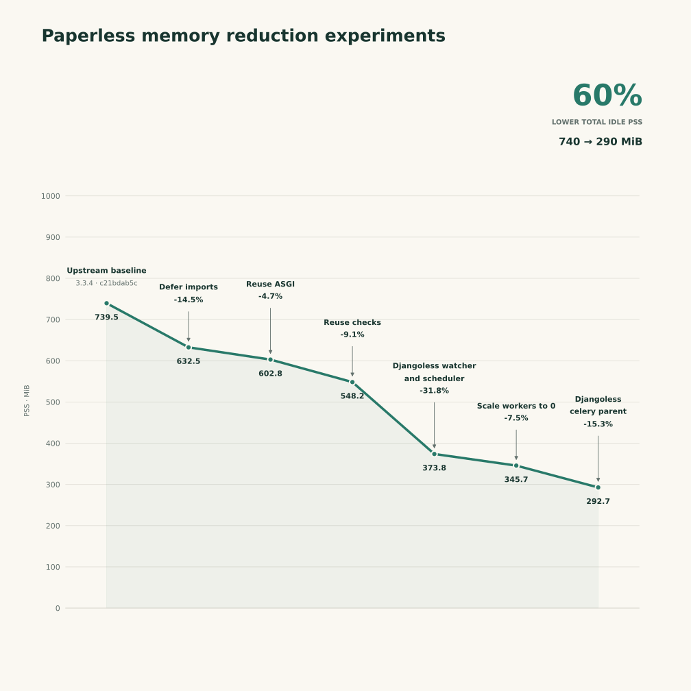

# Idle memory reduction analysis

The current development baseline is about 300 MB idle, as reported by the user.
The target workload is one home user and about two new documents per week.
First establish explicit operation and processing boundaries without losing
features. These boundaries must support larger component replacements later.
Do not prioritize small import or memory optimizations during this phase.
Measure the achievable idle reduction as components are replaced. Extra startup
time is acceptable; record memory after feature use and return-to-idle time.

The initial active-work goal is about 2 GB, with a proposed peak cap of 3 GB.
These are not idle targets or enforced runtime limits. Confirm the measurement
scope and include all local services before comparing deployment totals.

For deployments using external OCR and AI services, set
`PAPERLESS_OCR_MODE=off`, `PAPERLESS_ARCHIVE_FILE_GENERATION=never` and
`PAPERLESS_AI_ALLOWED=false`. Match any saved OCR/archive preferences to these
values, since saved preferences take precedence. To replace default processing
entirely, select an implementation with `PAPERLESS_PARSER`. Remote OCR permission
remains separate. The AI deployment limit disables Paperless AI suggestions,
chat, embeddings and vector indexing. Implementations remain unloaded on disabled paths. Existing
text extraction, thumbnails and ordinary document operations still run.

For deployments that delegate OCR and matching to external services, use:

```ini
PAPERLESS_OCR_MODE=off
PAPERLESS_ARCHIVE_FILE_GENERATION=never
PAPERLESS_CLASSIFIER_ENABLED=false
PAPERLESS_TRAIN_TASK_CRON=disable
PAPERLESS_AI_ALLOWED=false
```

The WebUI can change the default parser's OCR/archive preferences; it cannot
override the AI deployment restriction. Saved AI preferences remain retained.
Restart existing processes after changing these settings to release libraries
or models loaded earlier. These settings prevent local OCR, ML matching (including
storage paths), and built-in AI engines from loading during ordinary document
workflows. Manual assignments, rule-based matching, and full-text search remain
available. Image-only documents need external OCR to obtain searchable text;
Paperless will still generate thumbnails but will not generate archive PDFs.
Installing engine packages in the container does not itself load them into RAM.



I have run experiments. A reduction of at least 25% is achievable with minimal changes to the code, and no behavior changes at all.
Further large savings require running the folder watcher, celery scheduler and celery parent without django, and keeping django inside workers that can scale to 0. It's not a revolution in the code base by any means, but I'll keep those to a fork since there is no interest.

The changes I will propose upstream:

1. **Make shared modules safe to import**: Importing task definitions, views or parser registrations should not also load the processing engines behind them. For example, documents.views imported AI classification and chat implementations at module scope, while `documents.tasks` imports AI indexing implementations, even when AI is disabled. The change keeps registration and shared interfaces lightweight, importing implementations only when an operation actually needs to run. The same applies to OCR, PDF processing, classifiers and parser dependencies.
1. **Reuse the initialized ASGI application**: asgi.py already creates a Django ASGI application before importing routing, but then calls get_asgi_application() again for HTTP routing. Reusing the existing instance avoids retaining a second middleware stack.
1. **Run Docker startup checks once**: The Docker initialization already runs Django system checks before starting the services. The consumer, scheduler and worker then repeat them. Their Docker launchers can skip those repeated checks while retaining the initial validation gate. **This does not affect bare-metal/systemd deployments**: the change is confined to Docker S6 launch scripts; standalone management commands and Celery invocations keep their normal checks.

For the curious among us:

4. **Djangoless watcher and scheduler**: Replaced by a small filesystem watcher and Supercronic. Both require an API token. The watcher submits a relative file path and metadata from the consumption directory; **it does not upload the document over HTTP**. The lightweight scheduler only keeps time: when a job is due, it calls the API, and the already-running Django web process queues the configured Celery task for the existing worker to execute. This is exactly what the current scheduler does, except that it doesn't call the API and it takes 150 MiB and a full django setup :/
5. **Djangoless Celery parent and scale workers down to 0**: it moves Django initialization out of the remaining parent and into task children and temporary helpers. This has larger compatibility implications, since we must then avoid using django models in the celery parent.

| Component                            | Upstream idle |    Final idle |
| ------------------------------------ | ------------: | ------------: |
| Web application and server processes |     242.1 MiB |     203.8 MiB |
| Folder watcher                       |     147.9 MiB |      21.0 MiB |
| Scheduler                            |     161.0 MiB |      10.1 MiB |
| Celery parent                        |      98.3 MiB |      57.8 MiB |
| Celery children                      |      90.2 MiB |       0.0 MiB |
| **Total**                            | **739.5 MiB** | **292.7 MiB** |

## Selecting resident service implementations

Resident services now use explicit implementation classes rather than feature
flags. Defaults retain the traditional consumer, scheduler and worker. To select
the lightweight variants, set `PAPERLESS_CONSUMER_CLASS=paperless_services.watcher.APIConsumer`,
`PAPERLESS_SCHEDULER_CLASS=paperless_services.scheduler.APIScheduler` and
`PAPERLESS_WORKER_CLASS=paperless_worker.bootstrap.LeanWorker`. Each is independent.
Remove the retired `PAPERLESS_USE_API_CONSUMER`, `PAPERLESS_USE_API_SCHEDULER` and
`PAPERLESS_USE_LEAN_WORKER` variables: active services reject their presence rather
than silently choosing a different implementation. See the
[configuration/migration reference](configuration.md#service-implementations) and
[service contract](document-operations.md#service-implementation-contract-37).
The launcher and lifecycle interface remain Django-free; no new memory savings
are claimed by this selection change.
