# Operations API

This is the current reference for requesting document processing, executing a
remote operation, and cancelling or resolving work. Deployment and account
provisioning are described in [processor deployment](processor-deployment.md).

A **job** is a durable document-processing request, identified by a UUID
`job_id`. A job can contain several **operations**, each identified by its
job-local `key` and a stable UUID `id`. An operation is one finite computation,
such as `parser.process`. An **execution attempt** starts when an operation is
claimed: it has a processor account, a fresh opaque `token`, a `lease_until`
deadline, and an incremented `attempts` count. Retrying delivery of a computed
result is not another computation attempt.

## Choose the caller role

| Caller                              | Authorization                                                                                                        | Endpoint sequence                                                                         |
| ----------------------------------- | -------------------------------------------------------------------------------------------------------------------- | ----------------------------------------------------------------------------------------- |
| Document requester/application      | Normal API authentication; active user with `documents.change_document` and change permission on the target document | `POST /api/operations/`, then observe Tasks/document results                              |
| Remote processor                    | Normal API authentication plus the operation's retained `documents.process_*` capability                             | Discover pending work, claim, download inputs, compute, upload outputs, submit result     |
| Requester or administrator          | Active original requester or active superuser                                                                        | `POST /api/operations/{job_id}/cancel/`                                                   |
| Administrator resolving uncertainty | Active superuser                                                                                                     | Investigate an `unknown` operation, then `POST /api/operations/{job_id}/{key}/reconcile/` |

Processor capabilities do not grant document-edit permission. Conversely,
document-edit permission does not authorize claiming processor work. Parser work
requires `documents.process_parser`; rich metadata requires
`documents.process_metadata`. Grants and account activity are rechecked, including
before core acceptance. The original requester's document and relation/entity
permissions are also checked when applying proposed changes; a processor cannot
grant itself permission to publish them.

The examples below use ordinary token authentication:
`Authorization: Token <account-api-token>`. This is the account's API token,
not an operation claim token. The shipped client reads its account token from
`PAPERLESS_API_TOKEN_FILE=/run/secrets/paperless_api_token`, mounted by the
[client Compose example](../providers/paperless-inference/compose.workstation.yml).
Use separate requester/administrator credentials in those callers' own secret
files. All credentials, hashes, identifiers and content in examples are
placeholders. Keep real API/model credentials in Compose secrets; do not put
them in request examples, source control or logs. Use HTTPS outside an isolated
trusted test network. Session authentication retains its normal CSRF rules.

## Request processing

An application requests work on an **existing document** with:

```http
POST /api/operations/ HTTP/1.1
Authorization: Token <requester-api-token>
Content-Type: application/json

{
  "request_id": "145948f0-2f58-4d09-ae1d-cb550c8c39ca",
  "document_id": 42,
  "operation": "ocr_metadata"
}
```

```http
HTTP/1.1 202 Accepted
Content-Type: application/json

{
  "job_id": "145948f0-2f58-4d09-ae1d-cb550c8c39ca",
  "status": "queued"
}
```

`request_id` must be a UUID and `document_id` a positive integer. Supported
request operations are `ocr`, `metadata`, and `ocr_metadata`. `ocr` queues
reprocessing with remote OCR permitted; placement still follows configured
processor eligibility. `metadata` queues the configured enrichment provider.
`ocr_metadata` retains the intent to admit a separate, deterministic metadata job
after OCR publication. The returned status is the retained job's current status;
an idempotent retry can return a later status than `queued`.

Generate the request ID once and reuse it with the same document, requester and
operation when retrying an uncertain submission. This returns the existing job,
without resetting its snapshots or executing a new request. Reusing the ID for
a different request conflicts (`409`). Use a new UUID for deliberately new work,
including a new attempt after inspecting a terminal failure.

This endpoint requests processing; it does not claim an operation or select the
processor account. It does not upload a new document. The existing
[`POST /api/documents/post_document/` upload API](api.md#file-uploads) and
UI ingestion continue to admit their own document jobs. Existing UI/API
reprocess entry points also continue to admit reprocessing through core. Callers
using those entry points do not need to submit the same work here again.

Follow Tasks and verify the resulting document and search state. A job may be
queued or waiting while no eligible processor is online. OCR completion in an
`ocr_metadata` request does not establish completion of its separate metadata
job.

## Execute work

Only remotely permitted, capability-authorized operations are discoverable with
`GET /api/operations/?status=pending`. The response is a bare array, not a
paginated object. An empty array means no currently eligible pending operation;
it is not an error. Discovery grants no lease and consumes no attempt.

Without the `status` parameter, `GET /api/operations/` includes authorized
operations in other states and operations belonging to the original requester.
It returns status and retained error messages, not computation inputs, claim
tokens or arbitrary job data. `pending` is the only supported status filter.

### An OCR exchange

These HTTP messages illustrate one successful exchange. Retain the full actual
claim and provider result; the claim response below shows selected fields only.
Do not manufacture provider identity, settings, revision, provenance or file
hashes from these placeholders.

1. Discover work using the processor account's API token:

   ```http
   GET /api/operations/?status=pending HTTP/1.1
   Authorization: Token <processor-api-token>
   ```

   ```json
   [
     {
       "job_id": "145948f0-2f58-4d09-ae1d-cb550c8c39ca",
       "key": "parser.process",
       "id": "89371a08-a327-59d6-b81d-10c2a16b0895",
       "operation": "parser.process",
       "status": "pending",
       "job_status": "waiting",
       "error": ""
     }
   ]
   ```

2. Claim the discovered `job_id` and `key` (URL-encode the key as one path
   segment). The operation `id` identifies the computation; it is not substituted
   for the job ID or key in endpoint URLs.

   ```http
   POST /api/operations/145948f0-2f58-4d09-ae1d-cb550c8c39ca/parser.process/claim/ HTTP/1.1
   Authorization: Token <processor-api-token>
   ```

   ```json
   {
     "version": 2,
     "id": "89371a08-a327-59d6-b81d-10c2a16b0895",
     "operation": "parser.process",
     "plugin": "paperless-inference.paddle:1",
     "status": "leased",
     "token": "<claim-token>",
     "attempts": 1,
     "lease_until": "2026-11-07T12:30:00+00:00",
     "remote_allowed": true,
     "input": {
       "request": {
         "version": 1,
         "revision": "<retained-revision>",
         "source": {
           "path": "parser-example-input/input.pdf",
           "size": 12345,
           "sha256": "<source-sha256>"
         },
         "output_dir": "parser-example"
       }
     }
   }
   ```

   A normal lease response is `200`. Check `status`, not just the HTTP code:
   expiry of non-replay-safe work can return `{"status":"unknown","id":"..."}`,
   and an exhausted attempt budget can return
   `{"status":"failed","id":"..."}`. Neither grants execution. An active
   competing lease or a nonpending operation conflicts (`409`).

3. Download each declared immutable input using **both** credentials:

   ```http
   GET /api/operations/145948f0-2f58-4d09-ae1d-cb550c8c39ca/parser.process/files/?path=parser-example-input%2Finput.pdf HTTP/1.1
   Authorization: Token <processor-api-token>
   X-Operation-Token: <claim-token>
   ```

   A successful download is `200` with file bytes. Only paths declared as file
   references in this operation's retained input are readable; arbitrary job,
   document, server and output paths are not. Check the declared size and SHA-256,
   reject traversal/symlinks, and keep inputs unchanged during computation.

4. Execute the locally configured installed parser with the retained request.
   Check its identity, effective configuration and execution declaration before
   computing. The operation envelope is version 2; parser and rich-metadata
   request/result contracts are version 1. The shipped client implements only
   `parser.process` and `metadata.enrich`, defaulting to `PaddleOCRProvider` and
   `MetadataProvider`. See [provider selection and swapping](../providers/paperless-inference/README.md#select-providers-for-the-remote-processor)
   for installing replacements and the portable-request limits. Generic file
   transport does not imply support for classification, thumbnails, search,
   ingestion or arbitrary journal operations.

5. Upload each result file as multipart form data, with field name `file`:

   ```http
   POST /api/operations/145948f0-2f58-4d09-ae1d-cb550c8c39ca/parser.process/files/ HTTP/1.1
   Authorization: Token <processor-api-token>
   X-Operation-Token: <claim-token>
   Content-Type: multipart/form-data; boundary=example-boundary

   --example-boundary
   Content-Disposition: form-data; name="file"; filename="archive.pdf"
   Content-Type: application/octet-stream

   <computed archive bytes>
   --example-boundary--
   ```

   ```http
   HTTP/1.1 201 Created
   Content-Type: application/json

   {
     "path": "parser-example/<claim-token>/archive.pdf",
     "size": 23456,
     "sha256": "<archive-sha256>"
   }
   ```

   The server stages the upload privately under the attempt's token, within the
   declared output directory. Replace the local result reference with this
   server reference after checking its size/hash. Repeating the same filename
   with identical bytes returns `200` and the same reference; different bytes
   conflict (`409`). Distinct outputs must have distinct upload names. The
   shipped client derives names from content hashes to avoid basename collisions.

6. Submit the actual complete provider result, using the claim token in the
   **JSON body**, and the account token in `Authorization`:

   ```http
   POST /api/operations/145948f0-2f58-4d09-ae1d-cb550c8c39ca/parser.process/result/ HTTP/1.1
   Authorization: Token <processor-api-token>
   Content-Type: application/json

   {
     "token": "<claim-token>",
     "result": {
       "version": 1,
       "revision": "<retained-revision>",
       "provider": "paperless-inference.paddle:1",
       "execution": "<retained-selection-identity>",
       "text": "Example invoice text",
       "page_count": 1,
       "date": null,
       "archive": {
         "path": "parser-example/<claim-token>/archive.pdf",
         "size": 23456,
         "sha256": "<archive-sha256>"
       },
       "thumbnail": null,
       "archive_type": "pdfa",
       "provenance": {
         "schema_version": 1,
         "source_sha256": "<source-sha256>",
         "page_count": 1
       }
     }
   }
   ```

   ```http
   HTTP/1.1 202 Accepted
   Content-Type: application/json

   {"status": "staged", "id": "89371a08-a327-59d6-b81d-10c2a16b0895"}
   ```

   Preserve additional provider fields, including full OCR provenance, rather
   than reducing real results to the illustrative values above. `202` means the
   proposal was staged, not that the document was published. Core resumes and
   validates files, identities, current permissions and document revision before
   accepting the operation and continuing the job. Invalid/stale proposals can
   later become `conflicted` with a `rejected` job. No processor endpoint directly
   writes authoritative document content.

The lease lasts the job's recorded timeout, or 1800 seconds if unset. There is no
renewal endpoint. Expired/reassigned tokens cannot access files or submit new
results. Recovery or a later claim can reopen expired replay-safe work, up to
three actual attempts; unclaimed waiting consumes neither a lease nor an attempt.
Expired non-replay-safe work becomes `unknown` and requires review. Do not assume
that a timeout proves an external action did not happen.

Keep computed results and files durably before delivery. After an uncertain
result response, resend the same token and identical result: for the same
processor this returns `202` with `staged` or `succeeded` when already recorded,
without recomputing. For an already staged or succeeded result, this equality
check runs before claim-expiry validation, so an identical retry can still be
acknowledged after the lease expires. It does not renew a lease or authorize
changed results. Account/grant checks still apply. The shipped client persists
this delivery record and retries delivery before claiming new work. See the
deployment guide for preserving its private state across upgrades.

### Operation and job states

```mermaid
stateDiagram-v2
    [*] --> pending
    pending --> leased: claim starts attempt
    leased --> staged: result proposal
    staged --> succeeded: core validates and accepts operation
    staged --> conflicted: validation fails; job rejected
    leased --> pending: expired and replay-safe; recovery/reclaim
    pending --> failed: three attempts exhausted
    leased --> unknown: uncertain non-replay-safe outcome; job attention
    unknown --> staged: administrator reconciles
    pending --> cancelled: cancel job
    leased --> cancelled: cancel replay-safe work
    leased --> unknown: cancel non-replay-safe work
    unknown --> reconciled_cancelled: reconcile cancelled job
```



`succeeded` here means the **operation** result was accepted. The containing job
can still have publication, follow-up, search, notification or cleanup work.
Cancellation preserves already succeeded operations. A reconciled cancelled
operation records the external outcome without restarting the job. Follow Tasks,
the job's retained diagnostics and the actual document/search result for overall
completion; disappearance from the pending list alone establishes none of these.

## Cancel work

The active original requester or an active superuser may cancel:

```http
POST /api/operations/145948f0-2f58-4d09-ae1d-cb550c8c39ca/cancel/ HTTP/1.1
Authorization: Token <requester-api-token>
```

Success is `204 No Content`. A processor capability alone does not permit
cancellation. Jobs already `committed` or `succeeded` conflict (`409`), because
published work cannot be cancelled.

Cancellation marks the job cancelled and task history revoked, invalidates late
claim use, and retains inputs and outcomes. Unfinished operations are cancelled,
except leased non-replay-safe operations become `unknown`; accepted operations
remain succeeded. It does not stop an already running remote process, undo a
published document/change, reverse an external action or refund model costs.

## Resolve an unknown outcome

Reconciliation is separate from ordinary processor execution. An active
**superuser**, not merely staff, the requester or a capability-bearing processor,
must investigate the external outcome and supply the operation-specific result
and a nonblank explanation:

```http
POST /api/operations/145948f0-2f58-4d09-ae1d-cb550c8c39ca/parser.process/reconcile/ HTTP/1.1
Authorization: Token <administrator-api-token>
Content-Type: application/json

{
  "result": "<complete operation-specific result object or value>",
  "evidence": "<administrator explanation of the observed external outcome>"
}
```

Replace the illustrative `result` placeholder with the complete value required
by that operation's contract, including any required valid private file
references. Only `unknown` operations can be reconciled. `evidence` is retained
with the administrator's account ID; it is an administrator-supplied explanation,
not proof that the API independently verifies. This endpoint requires no claim
token and does not replay the external computation.

Success is `202` with `{"id":"<operation-id>","status":"staged"}`; core still
validates the proposal. For a cancelled job the response status is instead
`reconciled_cancelled`: the outcome is recorded without resuming or publishing
the cancelled work. Missing `result` is `400`; missing/blank evidence or a state
other than `unknown` conflicts (`409`). Reconciliation is not a bypass for
ordinary validation failures or a way to turn a known failure into success.

## HTTP status and retry behavior

| Status        | Meaning for callers                                                                                                                                                                                                                                                                                                         |
| ------------- | --------------------------------------------------------------------------------------------------------------------------------------------------------------------------------------------------------------------------------------------------------------------------------------------------------------------------- |
| `200`         | Successful discovery, claim response, input download, or identical existing upload. Inspect claim `status` before executing.                                                                                                                                                                                                |
| `201`         | A new private output upload was stored. It is not document publication.                                                                                                                                                                                                                                                     |
| `202`         | A processing request was admitted, a result was staged/already recorded, or reconciliation was recorded. Follow subsequent completion.                                                                                                                                                                                      |
| `204`         | Cancellation completed; no response body.                                                                                                                                                                                                                                                                                   |
| `400`         | Invalid request fields, unsupported status filter, missing upload `file`, missing result token/result, or missing reconciliation result. Correct the request.                                                                                                                                                               |
| `401` / `403` | Normal authentication failure; `403` also covers missing/revoked capabilities, server-only operations, undeclared file access, cancellation by another user, or nonadministrator reconciliation. Do not retry with broader assumptions about grants.                                                                        |
| `404`         | The target document or referenced job does not exist, or the URL does not match a route (including malformed UUID job paths).                                                                                                                                                                                               |
| `409`         | Busy job lock, incompatible request ID reuse, rejected document/requester snapshot or permission, active competing lease, stale/expired claim, nonpending/unclaimable operation, conflicting immutable upload, published-job cancellation, or invalid reconciliation state/evidence. Inspect current state before retrying. |

The server serializes operation mutations with core execution. A transient lock
conflict may be retried after rediscovery; a conflict does not authorize duplicate
computation. Result receipt and broker dispatch are separate: if continuation
publication fails, the durable staged result remains available for recovery.
Keep the same submission/result identities after a lost response. Do not treat
transport acceptance, a Celery invocation ending, or an accepted individual
operation as final document success.
